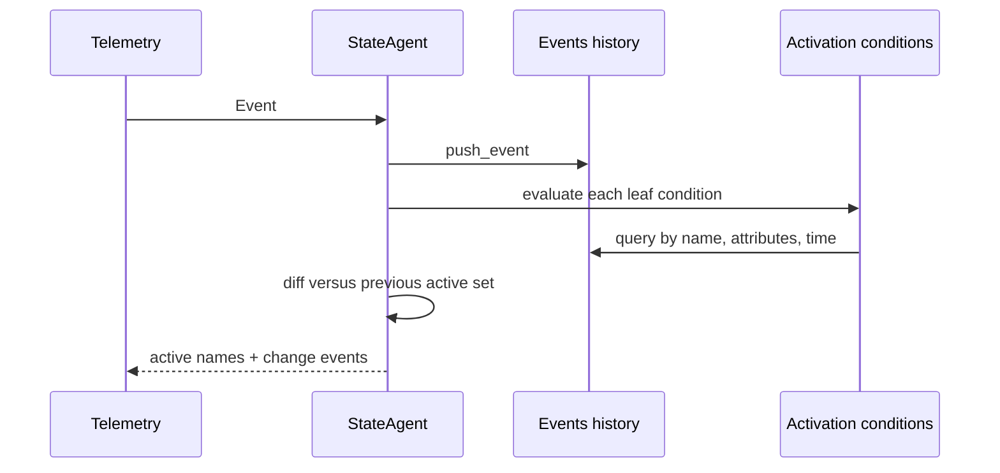

# event_statemachine_follow

Rust library that keeps a living status of one physical object from the traces that object already emits.

You describe the aspects you care about — unconnected, un-enrolled, operating, hot — as sentences over event history. A `StateAgent` bound to one device id stores those traces and, on every arrival, tells you which aspects are true now and which ones just flipped.

```text
NOT (enrollment since 2 hours from now OR connection_to_cloud since 2 hours from now)
```

That sentence is a state. Silence for two hours becomes `not_operational.unconnected`. Freshness, absence, and attribute checks (`status == true`, `value > 30`) are how you name the condition of a real device.

The crate is autonomous: activation rules are plain condition strings. It evaluates them against a per-device history. It carries transition actions (`enroll_device`, `resume_operation`) as metadata so the host that is allowed to touch the hardware can decide what to do.

## Status of one display

Several aspects can be true at once. Names are dotted paths: the group is a label, the leaf is the aspect.

| Moment | Active aspects |
|--------|----------------|
| First look, no traces | `not_operational.unconnected`, `not_operational.un_enrolled` |
| Enrollment id created | `not_operational.unconnected` |
| Cloud connection in the window | *(none of the watched aspects)* |
| Connection trace for this display | `operational.operating` |
| Temperature 40 in the last hour | `operational.operating`, `operational.hot` |
| Two hours after that trace | `not_operational.unconnected` |

Each arrival also returns only the diffs: `state_activated` and `state_deactivated`, stamped with the same time as the trace that caused them.

## Add the crate

This package is a member of the [Fleetee](https://github.com/fleetee/fleetee) workspace (`MIT`, Rust 2021). From another crate in that workspace:

```toml
[dependencies]
event_statemachine_follow = { path = "../event_statemachine_follow" }
```

From the workspace root:

```bash
cargo test -p event_statemachine_follow
cargo run -p event_statemachine_follow --example factory_display
```

Expression parsing uses the workspace copy of [`antlr-rust`](../antlr4rust).

## Use it

Three steps: declare the machine, open one follower per device, feed events.

```rust
use event_statemachine_follow::{
    event::{Event, EventValue},
    follow::StateAgent,
    state_description::StateDescription,
};
use std::collections::HashMap;

let description = StateDescription::from_json(r#"{
  "states": {
    "hot":  { "facts": { "condition": "temperature#[value > 30] since 1 hour from now" } },
    "cold": { "facts": { "condition": "temperature#[value < 10] since 1 hour from now" } }
  }
}"#)?;

let mut agent = StateAgent::new("factory_display_001".into(), description)?;

let event = Event::new(
    "temperature".into(),
    false,
    HashMap::from([("value".into(), EventValue::Float(40.0))]),
    1_000,
);

let (active, changes) = agent.event_arrived_so_evaluate_states(&event)?;
// active contains "hot"
// changes contains a state_activated event whose attribute "state" is "hot"
```

`event_arrived_so_evaluate_states` returns:

| Value | Meaning |
|-------|---------|
| `Vec<String>` | Full set of active state names after this event |
| `Vec<Event>` | Diffs only: `state_activated` / `state_deactivated`, attribute `state` |

A host updates its picture from the full set and forwards the diffs:

```rust
let (active, changes) = agent.event_arrived_so_evaluate_states(&event)?;
update_dashboard(&agent.id, &active);
for change in changes {
    forward_to_bus(change);
}
```

Keep **one agent per device id**. The id in a fleet is the device id; its history stays private to that follower.

The JSON key for an activation rule is `"facts"`. In Rust the same rule is `State::activation` (`ActivationRule { condition }`).

## Write a condition

A condition is a sentence about **stored history**. It is true when that history still contains a match, including a match older than the latest event. Put a time window on the sentence when “latest reading only” is what you mean.

| You want to know | Sentence |
|------------------|----------|
| This event has been seen | `enrollment_id_created` |
| This event has never been seen | `NOT enrollment_id_created` |
| Attribute test | `temperature#[value > 30]` |
| Combined attributes | `ConnectionTraceFromDevice#[wifi == "factory_display_001" AND status == true]` |
| Both have occurred | `enrollment_id_created AND connection_to_cloud` |
| Seen in the last two hours | `connection_to_cloud since 2 hours from now` |
| Silent for two hours | `NOT (enrollment since 2 hours from now OR connection_to_cloud since 2 hours from now)` |
| Any trace in the last hour | `* since 1 hour from now` |

`since` applies to the single event term on its left. `now` is the timestamp of the event being evaluated. Units are lowercase: `second(s)`, `minute(s)`, `hour(s)`. `AND` binds tighter than `OR`. Parentheses close a `NOT`.

Full writing guide: **[doc/expressions.md](doc/expressions.md)**. How the same sentences answer queries from EQL, Esper, Siddhi, Flink CEP, and AWS IoT SQL: **[doc/analyze.md](doc/analyze.md)**.

## Declare the machine

A state description is JSON. Groups nest. Leaves carry the sentence. Transitions are named edges for the host; the follow loop evaluates leaf activations.

```json
{
  "states": {
    "not_operational": {
      "states": {
        "unconnected": {
          "description": "No enrollment or cloud connection in the last 2 hours",
          "facts": {
            "condition": "NOT (enrollment since 2 hours from now OR connection_to_cloud since 2 hours from now)"
          }
        }
      },
      "transitions": [
        {
          "name": "enroll_device_transition",
          "from": "not_operational.unconnected",
          "to": "not_operational.un_enrolled",
          "condition": "user_validation_on_this_device_status since 1 minute from now",
          "action": { "name": "enroll_device", "description": "Enroll the display" }
        }
      ]
    }
  }
}
```

`from` and `to` use the full dotted path. Load with `StateDescription::from_json`, then `to_state_machine()` when you want the graph. Call `StateMachine::evaluate_transitions` when the host should see which actions are ready. The agent records status; it leaves the command to the host.

Grammar, JSON shape, and parse APIs: **[doc/parsing.md](doc/parsing.md)**.

## Follow loop



Conditions match the whole store. A hot reading at `t=1000` keeps `temperature#[value > 20]` true after a cold reading at `t=1001`, because the earlier event is still there. `since 1 hour from now` is how a description forgets it.

## Example

[`examples/factory_display.rs`](examples/factory_display.rs) follows one display from the first look through enrollment, two hours of silence, a cloud connection, a temperature of 40, and the windows closing again.

```bash
cargo run -p event_statemachine_follow --example factory_display
```

```text
first look, no traces yet
  event clock @ 200000
  now: not_operational.un_enrolled, not_operational.unconnected
  + not_operational.un_enrolled
  + not_operational.unconnected

a technician validates the display
  event user_validation_on_this_device_status @ 200010
  now: not_operational.un_enrolled, not_operational.unconnected
  action ready: enroll_device (not_operational.unconnected → not_operational.un_enrolled)

the display enrolls
  event enrollment @ 200130
  now: (none)
  - not_operational.unconnected

temperature 40
  event temperature @ 207381
  now: operational.hot, operational.operating
  + operational.hot

two hours after the connection trace
  event clock @ 214562
  now: not_operational.unconnected
  + not_operational.unconnected
  - operational.operating
```

`+` / `-` are `state_activated` / `state_deactivated`. `action ready` is a transition whose condition holds; the example prints the action name and leaves execution to the host.

## Documentation

| Guide | What it covers |
|-------|----------------|
| [Tutorial](doc/tutorial.md) | End-to-end: events, expressions, JSON, `StateAgent`, transitions, pitfalls |
| [Expressions](doc/expressions.md) | How to write a condition sentence |
| [Analyze](doc/analyze.md) | Which queries from other event languages the sentence fulfills |
| [Parsing](doc/parsing.md) | Time-expression grammar, JSON state file, parse APIs |
| [Library](doc/library.md) | Modules, types, and functions |
| [Service](doc/service.md) | `StateAgent` contract and integration flow |
| [Marketing](doc/marketing.md) | Positioning: status of a physical object |
| [Doc index](doc/README.md) | Same map, plus the module diagram |

Suggested path: tutorial, then expressions, then the `factory_display` example. Library and service are the API reference once the loop is familiar.

## Layout

| Path | Role |
|------|------|
| `src/event.rs` | `Event`, `EventValue` |
| `src/event_parser/` | ANTLR grammar and expression evaluation |
| `src/event_filter_executor.rs` | Ordered per-device history (`Events`) |
| `src/state_description.rs` | JSON description → runtime graph |
| `src/state_machine.rs` | Aspects, transitions, `Command` metadata |
| `src/follow/` | `StateAgent` |
| `examples/factory_display.rs` | One display, followed |
| `tests/state_description.json` | Larger description fixture |

## License

MIT. Authors: Fleetee Team.
