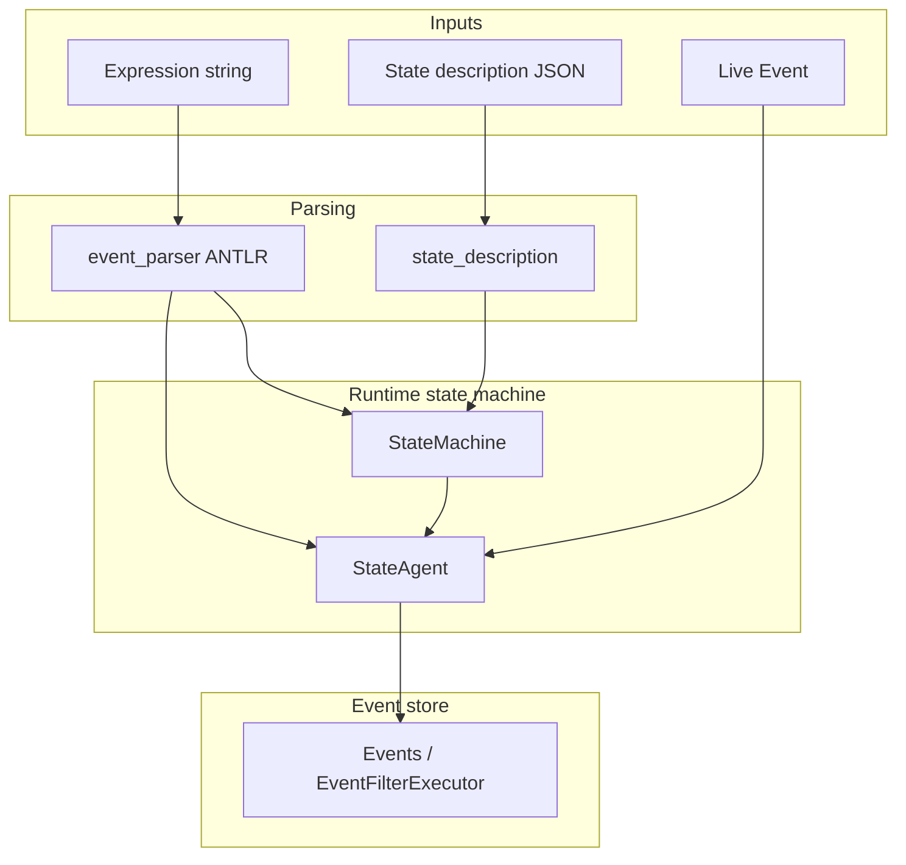

# `event_statemachine_follow` documentation

Autonomous Rust library for **event filtering** and **state-machine follow**: parse timed event expressions, keep an event history, load hierarchical state descriptions, and evaluate which states are active as events arrive.

This crate does **not** depend on fleetee domain facts. Activation rules are plain condition strings evaluated against events.

## Documents

| Doc | Topic |
|-----|--------|
| [tutorial.md](tutorial.md) | **Start here** — comprehensive how-to (manage + follow) |
| [expressions.md](expressions.md) | **Event expressions** — how to write a condition sentence |
| [analyze.md](analyze.md) | How those sentences fulfill queries from other event languages |
| [marketing.md](marketing.md) | Positioning — following the state of a physical object |
| [parsing.md](parsing.md) | Time/event expression grammar, JSON state DDL, parse APIs |
| [library.md](library.md) | Modules, types, and library functions |
| [service.md](service.md) | Runtime “follow” service (`StateAgent`) and integration flow |

Runnable example: `cargo run -p event_statemachine_follow --example factory_display` ([examples/factory_display.rs](../examples/factory_display.rs)). One display, followed from first look through enrollment, silence, operation, and a temperature reading.

## Architecture (modules)



## Quick start

```rust
use event_statemachine_follow::{
    follow::StateAgent,
    state_description::StateDescription,
    event::{Event, EventValue},
};
use std::collections::HashMap;

let description = StateDescription::from_json(r#"{
  "states": {
    "hot": { "facts": { "condition": "temperature#[value > 30]" } }
  }
}"#)?;

let mut agent = StateAgent::new("device-1".into(), description)?;

let event = Event::new(
    "temperature".into(),
    false,
    HashMap::from([("value".into(), EventValue::Float(40.0))]),
    1_000,
);

let (active_states, change_events) = agent.event_arrived_so_evaluate_states(&event)?;
```

JSON still uses the historical key `"facts"` for activation rules; in Rust the field is `State::activation` (`ActivationRule`).
