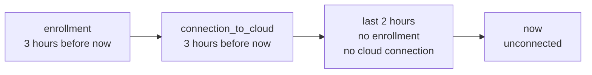
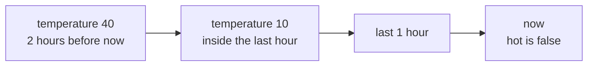
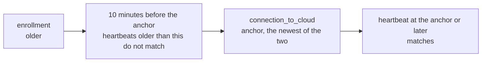
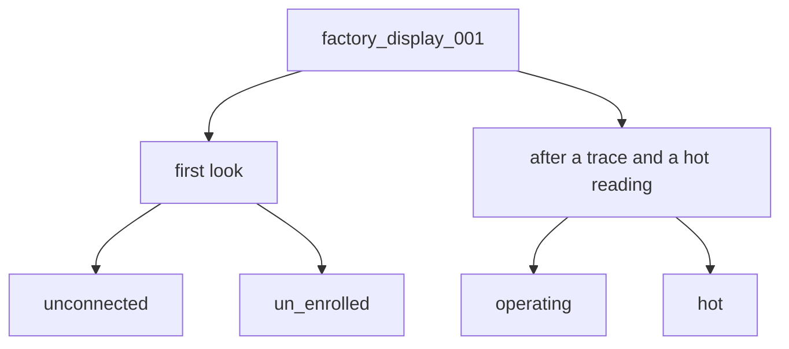
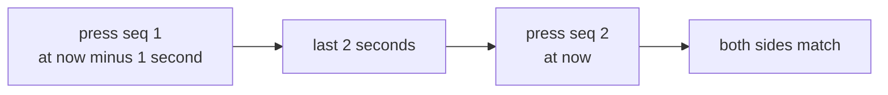

# Event expressions

How to write the condition strings used by this crate. A condition is the `facts.condition` of a state, or the `condition` of a transition. The same language is what `parse_expression` and `evaluate_filter_expression` accept.

Parser APIs and the JSON state file are in [parsing.md](parsing.md). A full follow loop is in [tutorial.md](tutorial.md). How the same sentences answer queries from other event languages is in [analyze.md](analyze.md).

A condition is a sentence about the **event history**. It is true when that history contains a match. One stored reading that still matches is enough, including a reading that arrived before the latest one.

## A sentence

```text
NOT (enrollment since 2 hours from now OR connection_to_cloud since 2 hours from now)
```

Read it as: neither an `enrollment` nor a `connection_to_cloud` is present in the two hours before the event being evaluated.

```text
ConnectionTraceFromDevice#[wifi == "factory_display_001" AND status == true] since 2 hours from now
```

Read it as: a `ConnectionTraceFromDevice` for this display, with `status` true, in that same two-hour window.

## What you can express

Each sentence is one question about the traces of one physical object. A state description uses one sentence per aspect, and several aspects can be true together. The names below are the event names your devices emit.

One display, followed. Each box is what the sentences say after that trace. `enroll_device` is offered only in the minute after validation.

```mermaid
flowchart LR
  look["first look\nunconnected\nun_enrolled"]
  check["technician validates\nenroll_device ready"]
  id["enrollment id created\nun_enrolled ends"]
  enrolled["enrollment\nunconnected ends"]
  quiet["two hours of silence\nunconnected returns"]
  trace["cloud connection and trace\noperating"]
  heat["temperature 40\noperating and hot"]
  cooled["one hour later\nhot ends"]
  stale["two hours after the trace\nunconnected returns"]
  look --> check --> id --> enrolled --> quiet --> trace --> heat --> cooled --> stale
```



The questions those boxes come from:

| You want to know | Sentence |
|------------------|----------|
| This object has been enrolled | `enrollment_id_created` |
| This object has never been enrolled | `NOT enrollment_id_created` |
| Enrollment and a cloud connection have both been seen | `enrollment_id_created AND connection_to_cloud` |
| Neither enrollment nor a cloud connection has ever been seen | `(NOT enrollment) AND (NOT connection_to_cloud)` |
| This display reported a successful connection | `ConnectionTraceFromDevice#[wifi == "factory_display_001" AND status == true]` |
| A temperature reading has been above 30 | `temperature#[value > 30]` |
| A temperature reading has been outside the normal band | `temperature#[value > 30 OR value < 5]` |
| A temperature above 30 arrived in the last hour | `temperature#[value > 30] since 1 hour from now` |
| The object has been silent for two hours | `NOT (enrollment since 2 hours from now OR connection_to_cloud since 2 hours from now)` |
| It is enrolled, and the cloud has not been reached in a day | `enrollment_id_created AND NOT (connection_to_cloud since 24 hours from now)` |
| Both a connection trace and a data collection succeeded in the last two hours | `ConnectionTraceFromDevice#[wifi == "factory_display_001" AND status == true] since 2 hours from now AND DataCollectionSuccess#[wifi == "factory_display_001" AND status == true] since 2 hours from now` |
| A heartbeat is at or after 10 minutes before the newest enrollment or cloud connection | `heartbeat since 10 minutes from last event of [enrollment, connection_to_cloud]` |
| Any trace at all arrived in the last hour | `* since 1 hour from now` |
| This display missed its schedule | `ScheduleMissed#[wifi == "factory_display_001" AND status == true]` |
| A technician validated this object in the last minute | `user_validation_on_this_device_status since 1 minute from now` |

Silence is a gap. The enrollment and the cloud connection are still in the history, and both sit outside the two hours before now, so `unconnected` is true.



A hot reading stays in the history after a colder one. Without a window the sentence `temperature#[value > 30]` is still true. The hour window keeps only the colder reading, so `hot` is false.



A time clause can use another trace as its anchor. The anchor is the newest of `enrollment` and `connection_to_cloud`. A heartbeat matches when its timestamp is at or after 10 minutes before that anchor. A heartbeat that arrives later still matches. A heartbeat more than 10 minutes before the anchor does not.



The same questions, as the status of one display. At first look the two `not_operational` aspects are true together. After a fresh connection trace and a hot reading, the two `operational` aspects are true together.



Each box is one `facts.condition` from the table. The description below is that picture written as JSON.

```json
{
  "states": {
    "not_operational": {
      "states": {
        "unconnected": {
          "description": "No enrollment or cloud connection in the last 2 hours",
          "facts": {
            "condition": "NOT (enrollment since 2 hours from now OR connection_to_cloud since 2 hours from now)"
          }
        },
        "un_enrolled": {
          "description": "No enrollment id has been created",
          "facts": {
            "condition": "NOT enrollment_id_created"
          }
        }
      }
    },
    "operational": {
      "states": {
        "operating": {
          "description": "A successful connection trace in the last 2 hours",
          "facts": {
            "condition": "ConnectionTraceFromDevice#[wifi == \"factory_display_001\" AND status == true] since 2 hours from now"
          }
        },
        "hot": {
          "description": "A temperature reading above 30 in the last hour",
          "facts": {
            "condition": "temperature#[value > 30] since 1 hour from now"
          }
        }
      }
    }
  }
}
```

A transition uses the same language to say when the host may act. This one is ready only while the validation is less than a minute old:

```json
{
  "name": "enroll_device_transition",
  "from": "not_operational.unconnected",
  "to": "not_operational.un_enrolled",
  "condition": "user_validation_on_this_device_status since 1 minute from now",
  "action": { "name": "enroll_device", "description": "Enroll the display" }
}
```

`cargo run -p event_statemachine_follow --example factory_display` feeds traces to that description and prints which of these sentences are true after each one.

## Names

An event name is a letter or `_`, then letters, digits, or `_`.

```text
enrollment
ConnectionTraceFromDevice
enrollment_id_created
```

These names are reserved and cannot be event names: `and`, `or`, `not`, `but`, `since`, `from`, `now`, `last`, `event`, `of`, `within`, `true`, `false`, `second`, `seconds`, `minute`, `minutes`, `hour`, `hours`.

`and`, `or`, `not`, and `but` also accept capitals (`AND`, `OR`, `NOT`, `BUT`). The time words do not: write `since`, `from`, and `now` in lowercase. `SINCE` does not parse. `NOW` is an ordinary event name, because the time word is the lowercase `now`.

`name@` is accepted. The `@` is a mark on the name. The lookup uses the name in front of it, so `connected@` matches an event named `connected`.

A bare name is true when at least one event of that name is stored.

```text
enrollment_id_created
```

## Attributes

Put a filter in square brackets after `#`. The event matches when its own attributes satisfy the filter.

```text
temperature#[value > 30]
payload#[wifi == "factory_display_001" AND status == true]
```

Comparisons are `>`, `<`, `>=`, `<=`, `==`, `!=`.

| Value in the sentence | Written as | Compares with |
|-----------------------|------------|----------------|
| Integer | `30` | integer or float attributes |
| String | `"factory_display_001"` | string attributes, `==` and `!=` |
| Boolean | `true` or `false` | boolean attributes, `==` and `!=` |

A quote inside a string is written `\"`. Decimal literals such as `30.5` do not parse. Compare a float attribute with an integer: `value > 30` matches a stored `40.0`.

Inside the brackets, `and` is tighter than `or`, and both group to the left. Parentheses work:

```text
temperature#[value > 30 OR (value < 0 AND status == true)]
```

An event that lacks the attribute does not match that comparison.

`name#[attr!]` parses. It asks whether `attr` was set on the evaluation context (`FilterContext`), which `StateAgent` does not do. It does not look at the attribute on the event. Write the comparison you mean: `payload#[wifi == "factory_display_001"]`.

## And, or, not

```text
enrollment AND connection_to_cloud
enrollment OR connection_to_cloud
NOT enrollment_id_created
```

`and` is tighter than `or`. Both group to the left.

```text
a OR b AND c    means    a OR (b AND c)
a AND b OR c    means    (a AND b) OR c
```

`NOT` applies to the rest of the sentence at that level, including a following `and` or `or`.

```text
NOT a AND b     means    NOT (a AND b)
NOT a OR b      means    NOT (a OR b)
```

Parentheses limit it:

```text
(NOT enrollment_id_created) AND connection_to_cloud
```

`and`, `or`, and `not` may be written in either case. Spaces and line breaks are ignored. The language has no comments.

## Time

A time clause sticks to the **one event term** on its left. It keeps events whose timestamp is greater than or equal to `anchor - duration`.

```text
enrollment since 2 hours from now
connection_to_cloud since 90 minutes from now
temperature#[value > 30] since 1 hour from now
```

| Piece | Write |
|-------|--------|
| Duration | a whole number, then `second`/`seconds`, `minute`/`minutes`, or `hour`/`hours` |
| Anchor `now` | the timestamp of the event being evaluated |
| Anchor `last event of […]` | the newest stored event named in the list |

```text
heartbeat since 10 minutes from last event of [enrollment, connection_to_cloud]
```

The list uses square brackets and commas. Braces do not parse. Each entry can be a name or a name with a `#[]` filter. `last event of […]` is only an anchor. It is not a sentence by itself.

Durations are converted to timestamp units: a second is `1`, a minute is `60`, an hour is `3600`. `since 2 hours from now` means “timestamp within 7200 units of the anchor.” Store timestamps in seconds if those words should mean clock hours. The anchor must be at least as large as the duration.

`since` cannot follow a parenthesis group. This does not parse:

```text
(enrollment OR connection_to_cloud) since 2 hours from now
```

Repeat the window on each term:

```text
NOT (enrollment since 2 hours from now OR connection_to_cloud since 2 hours from now)
```

On `a AND b since 1 hour from now`, the window applies to `b` only. `a` matches at any time. Put a window on every term that should be fresh.

If `last event of […]` names nothing that is stored, the `since` clause is skipped, and the term stays true whenever a matching event exists.

Without a window, an older match stays true after a newer non-match. After a `temperature` of `40` and a later `temperature` of `10`, `temperature#[value > 30]` is still true. The window is how a sentence means “recently”:

```text
temperature#[value > 30] since 1 hour from now
```

### Two events of the same name within 2 seconds

A name is true when at least one stored event matches. Writing the name twice still searches that same set, so one `press` in the window makes both sides true:

```text
press since 2 seconds from now AND press since 2 seconds from now
```

Give the two triggers different attributes. Each side then looks for its own event, and each side keeps only events in the two seconds before `now`:

```text
press#[seq == 1] since 2 seconds from now AND press#[seq == 2] since 2 seconds from now
```

`seq` is an attribute on the event. `1` and `2` are the two presses. Timestamps are in seconds, so `2 seconds` is 2 timestamp units. The sentence is true when both presses are stored and each has `timestamp >= now - 2`. The order of the two presses is not tested.



One numbered press, or the second press older than 2 seconds, leaves a side empty and the sentence is false.

When `StateAgent` evaluates, the arriving event is already in the history, and `now` is that event’s timestamp.

## Any event

`*` is true when the history contains any event. A window applies:

```text
* since 1 hour from now
```

`* BUT NOT noise` parses (`but` or `BUT`). The current evaluator does not remove the named event, so this is true whenever `*` would be true. Exclude a name with `NOT`:

```text
NOT noise
```

## Sentences that do not parse

| Written | Why |
|---------|-----|
| `since 10 minutes from now` | a time clause needs an event term on its left |
| `(a OR b) since 1 hour from now` | `since` follows one event term, not a group |
| `enrollment SINCE 1 hour FROM now` | `since` and `from` are lowercase |
| `temperature#[value > 30.5]` | values are integers, strings, or `true`/`false` |
| `last event of [a, b]` | this is an anchor, not a sentence |
| `within 10 minutes` | `within` is reserved and has no sentence form |
| `last event of {a, b}` | the list is `[a, b]` |

## Where a sentence goes

```json
{
  "states": {
    "not_operational": {
      "states": {
        "unconnected": {
          "facts": {
            "condition": "NOT (enrollment since 2 hours from now OR connection_to_cloud since 2 hours from now)"
          }
        }
      }
    }
  }
}
```

The JSON key is `facts`. In Rust the field is `activation`. The string itself is the expression.

The same string is a transition `condition`. The follow agent re-evaluates activation sentences on each event. Transition sentences are available for the host to evaluate when it decides whether an action is ready. See [service.md](service.md).

Grammar source: [`TimeExprGrammar.g4`](../../use_cases_event_state_machine_grammars/TimeExprGrammar.g4).
