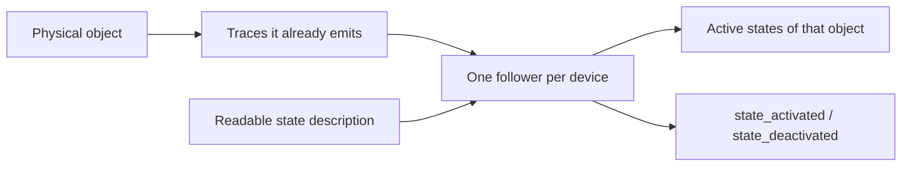

# Marketing: following the state of a physical object

Positioning note for `event_statemachine_follow`. Technical references stay in [tutorial.md](tutorial.md), [parsing.md](parsing.md), [library.md](library.md), and [service.md](service.md).

## Buyer sentence

Tell us what **this device is** right now, in words a technician can read, and the library will follow it as events arrive.

The product is a **living status of each physical object**, kept current from the traces that object already leaves. The unit of sale is the thing in the field (a display, a sensor, a machine), and the output is the set of states that thing currently occupies.



## What to lead with

### 1. One object, one follower

`StateAgent` is bound to an `id` and its own history. In this product the id is a device id. Status comes back as names of that object: `not_operational.unconnected`, `operational.operating`, `hot`.

Sell the follower of a device. The engine stays in the engineering appendix.

### 2. The object does not have to announce its state

Physical devices emit traces (`enrollment`, `connection_to_cloud`, `temperature`, `ConnectionTraceFromDevice`). The library turns those traces into status. The line for the first slide is already in the spec:

```text
NOT (enrollment since 72 hours from now OR connection_to_cloud since 72 hours from now)
```

That sentence is the product. Silence for 72 hours becomes “unconnected.” Freshness, absence, and attribute checks (`status == true`, `value > 30`) are how you name the condition of a real object.

### 3. A real object holds several truths at once

A device can be un-enrolled and unconnected together. The follow loop returns the full active set, so status is a picture of the object: connectivity, enrollment, temperature, duty, grouped under names like `not_operational` and `operational`.

Sell **aspects of the same object**. Dotted names are the labels on that picture.

### 4. Change what you watch by editing the description

Adjust the state description to reveal the operational view you want. The host keeps streaming the same events. Policy writers change JSON; application code stays on `event_arrived_so_evaluate_states`.

That is the adoption argument for anyone who already has telemetry and wants a new definition of “healthy” from a new description.

### 5. The moment a state flips is itself an event

Each arrival returns the full active set plus only the diffs:

| Return | What the buyer hears |
|--------|----------------------|
| Active state names | What this object is now |
| `state_activated` | The object just entered this state |
| `state_deactivated` | The object just left this state |

Each change carries the state name and the same timestamp as the trace that caused it. Downstream can light a dashboard, open a ticket, or notify a planner. The sale is the **transition of the physical object**, delivered as an ordinary event.

### 6. The library says when; the host decides to act

Transitions carry a condition and an action name (`enroll_device`, `resume_operation`) as metadata. The follow loop derives status. Commands stay in the system that is allowed to touch the hardware.

For equipment, that split is a trust point.

## How to show it

| Slide | Show | Say |
|-------|------|-----|
| The object | One device id, three named aspects | “This display is unconnected, un-enrolled, or operating.” |
| The sentence | The 72-hour `NOT (enrollment OR connection…)` line | “Status is a sentence over what the device did, and when.” |
| The follow | Event in → active names + `state_activated` | “Every new trace refreshes the object and emits only what changed.” |
| The policy | Same event stream, edited JSON | “A new operational view is a new description.” |

## What stays off the first slides

ANTLR, the `facts` wire key, parse lifetimes, and the module graph explain the crate. They belong in [library.md](library.md) and [parsing.md](parsing.md).

## Promise that matches the code

Market **time-bounded status**. Conditions match stored history, so an old hot reading can keep `hot` active after a later cold one. The promise is: what this object has shown, inside the window written in the description. `since … from now` is the definition of now.

See [tutorial.md](tutorial.md) §5.4 and §13.

The same story, as a program: `cargo run -p event_statemachine_follow --example factory_display`.
