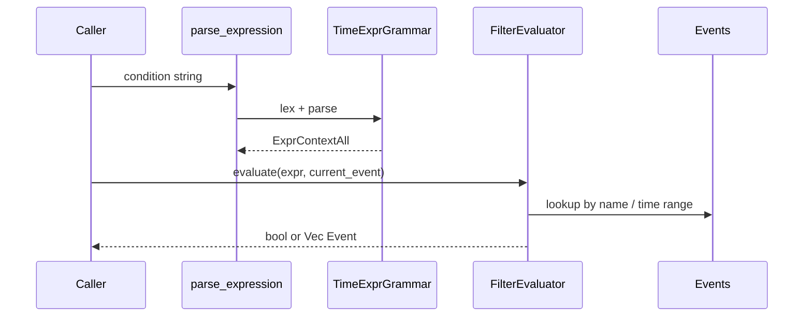
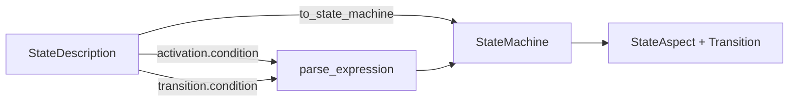

# Parsing

The crate parses two related languages:

1. **Timed event expressions** — boolean conditions over named events, attributes, and time windows. How to write them: [expressions.md](expressions.md).
2. **State description JSON** — hierarchical states, activation rules, and transitions that embed those expressions.

## 1. Timed event expressions (`event_parser`)

### Grammar source

- Human-editable grammar: [`use_cases_event_state_machine_grammars/TimeExprGrammar.g4`](../../use_cases_event_state_machine_grammars/TimeExprGrammar.g4)
- Generated Rust under `src/event_parser/` (`timeexprgrammarlexer`, `timeexprgrammarparser`, …)
- Runtime evaluator: `src/event_parser/mod.rs` (`FilterEvaluator`, `parse_expression`, …)

### Expression shape

Entry rule is `expr` → `booleanExpr`:

| Construct | Example | Meaning |
|-----------|---------|---------|
| Event name | `enrollment` | Matching events exist in history |
| Name with `@` | `connected@` | Accepted; lookup uses the name before `@`, so this matches `connected` |
| Attribute filter | `temperature#[value > 20]` | Events named `temperature` whose attrs match |
| Attribute existence form | `payload#[wifi!]` | Parses; see [expressions.md](expressions.md) — it does not read the event’s attributes |
| Wildcard | `*` | Any stored event. `* BUT NOT noise` parses; exclusion is not applied |
| Boolean ops | `A AND B`, `A OR B`, `NOT A` | Combine predicates |
| Time window | `connection since 72 hours from now` | Restrict matches relative to a time ref |
| Time ref | `now`, `last event of [a, b]` | Anchor for `since … from …` |

Numbers compare with `>`, `<`, `>=`, `<=`, `==`, `!=`. Strings and booleans compare with `==` and `!=`. A float attribute compares with an integer literal. Details and the cases that do not parse are in [expressions.md](expressions.md).

### Parse → evaluate pipeline



### Public parse / evaluate APIs

| Function / type | Role |
|-----------------|------|
| `parse_expression(input)` | Parse into `Rc<ExprContextAll<'input>>` |
| `evaluate_filter_expression(input, context, current)` | Parse + evaluate to `bool` |
| `evaluate_filter_event_expr(input, context, current)` | Parse + return matching `Event`s |
| `collect_events_from_expr(expr)` | Static analysis: event names + wildcard flag |
| `TimeExpressionParser` | Lower-level parser handle |
| `CompiledTimeExpression` | Owned `'static` expression for repeated evaluate |
| `FilterContext` | Holds `Rc<RefCell<Events>>` plus optional attrs / time ref |
| `FilterEvaluator` | Visitor that walks the parse tree against history |

**Lifetime:** the parse tree borrows the input string (`'input`). Runtime state machines often leak or re-parse with a `'static` string so conditions can live inside `StateMachine` / `Transition`.

### Evaluation semantics (important)

- Conditions are evaluated against the **event history** in `Events`, not only the latest event.
- `temperature#[value > 20]` stays true if *any* stored `temperature` event still matches, even after a later colder reading arrives.
- Time clauses (`since N hours from now`) use the **current / reference event** timestamp as the time anchor when evaluating.

## 2. State description JSON (`state_description`)

### Wire format

```json
{
  "states": {
    "operational": {
      "description": "optional",
      "facts": { "condition": "ConnectionTraceFromDevice since 24 hours from now" },
      "states": {
        "child": { "facts": { "condition": "…" } }
      },
      "transitions": [
        {
          "name": "go",
          "from": "operational.child",
          "to": "other.state",
          "condition": "some_event",
          "action": { "name": "do_it", "description": "…" }
        }
      ]
    }
  }
}
```

Notes:

- Nested `states` get dotted names (`parent.child`).
- JSON key **`facts`** is historical; Rust field is `activation: Option<ActivationRule>` (`pub type Facts = ActivationRule`).
- Transition `from` / `to` use full dotted state paths.
- Transition `condition` and activation `condition` are timed event expressions (section 1).

### Parse APIs

| API | Role |
|-----|------|
| `StateDescription::from_json` / `to_json` | Serde load/save |
| `StateDescription::to_state_machine` | Build runtime `StateMachine` (parses all conditions) |
| `StateParser` | Parse with estimated **source locations** (LSP / diagnostics) |
| `StateDescriptionWithLocation` | Decorated tree with `SourceLocation` |
| `get_all_state_names`, `get_leaf_states`, `get_state_condition`, … | Introspection |
| `collect_all_event_names_and_wildcards` | Union of events referenced by activations + transitions |

### From JSON to runtime



`to_state_machine`:

1. Walk nested states → `StateAspect` with `activation_conditions: Vec<String>`.
2. Resolve transition endpoints by full name.
3. Parse each transition condition into `Rc<ExprContextAll<'static>>`.
4. Attach optional `Command` from `action`.
