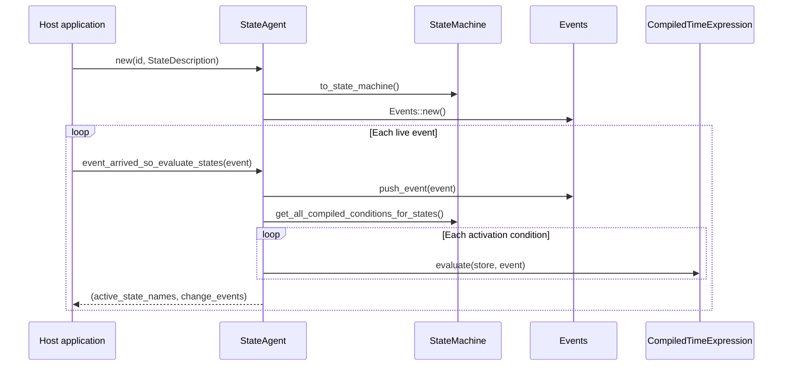

# Service: state-machine follow

The primary **service** this library provides is continuous **state following**: given a declarative state description and a stream of events, maintain the set of active states and emit activation / deactivation events.

The entrypoint is `StateAgent` (`follow`).

## What the service does

1. **Load** a `StateDescription` (JSON or in-memory).
2. **Compile** it into a `StateMachine` (aspects + transitions + parsed conditions).
3. **Remember** events per device in an `Events` store.
4. **On each new event**, re-evaluate every state’s activation conditions against history.
5. **Diff** previous vs new active sets and emit synthetic events:
   - `state_activated` with attribute `state`
   - `state_deactivated` with attribute `state`

It does **not** execute transition actions, command buses, or fact inference. `Command` on transitions is metadata for upper layers (fleetee, LSP, planners).

## Lifecycle



## API contract

```rust
impl StateAgent {
    pub fn new(
        id: String,
        description: StateDescription,
    ) -> Result<Self, Box<dyn std::error::Error>>;

    pub fn get_current_states(&self) -> HashSet<String>;

    pub fn event_arrived_so_evaluate_states(
        &mut self,
        event: &Event,
    ) -> Result<(Vec<String>, Vec<Event>), Box<dyn std::error::Error>>;
}
```

### Return value of `event_arrived_so_evaluate_states`

| Part | Meaning |
|------|---------|
| `Vec<String>` | Full list of currently active state names (dotted paths) |
| `Vec<Event>` | Diff events only (`state_activated` / `state_deactivated`), same timestamp as the triggering event |

### Held state

| Field | Role |
|-------|------|
| `id` | Caller-supplied identifier. A device id when the subject is a device |
| `events` | Shared `Rc<RefCell<Events>>` history |
| `state_machine` | Compiled graph |
| `current_states` | Last evaluation result |

## Integration patterns

### Embed in fleetee (or any host)

```text
MQTT / inventory / actors
        │
        ▼
   Event { name, attributes, timestamp }
        │
        ▼
 StateAgent::event_arrived_so_evaluate_states
        │
        ├──► update UI / inventory with active states
        └──► forward state_activated / state_deactivated downstream
```

`fleetee` re-exports this crate (`fleetee::event`, `fleetee::follow`, `fleetee::ddl::state_description`, …) so existing call sites can stay on the fleetee path while the implementation lives here.

### Offline / tooling

- **LSP** (`fleetee-lsp`): uses `StateParser` locations + expression parse checks without running the agent.
- **Tests / benches**: build `StateAgent` from fixtures under `tests/state_description.json`.

### Multi-device

Instantiate one `StateAgent` per device id. History is not shared across agents unless you deliberately share the `Events` `Rc` (not exposed by `new` today).

## Activation vs transitions

Today the follow loop evaluates **state activation conditions** (`ActivationRule.condition` → `activation_conditions` on each aspect).

Transition conditions are parsed into the graph and available via `StateMachine::evaluate_transitions` / `get_all_needed_events`, but the agent’s hot path does not automatically fire transitions or run `Command`s. Hosts that need transition-driven behavior should call those APIs explicitly or extend the agent.

## Guarantees and non-goals

**Provides**

- Autonomous parse + evaluate of timed event expressions
- Hierarchical state description → runtime graph
- Event-history–based activation follow with change events
- No coupling to fleetee `Fact` / `FactDomain`

**Does not provide**

- Network I/O, actors, persistence
- Fact ontology or inference
- Automatic command execution on transitions
- Single-event-only semantics (history participates in matches)
