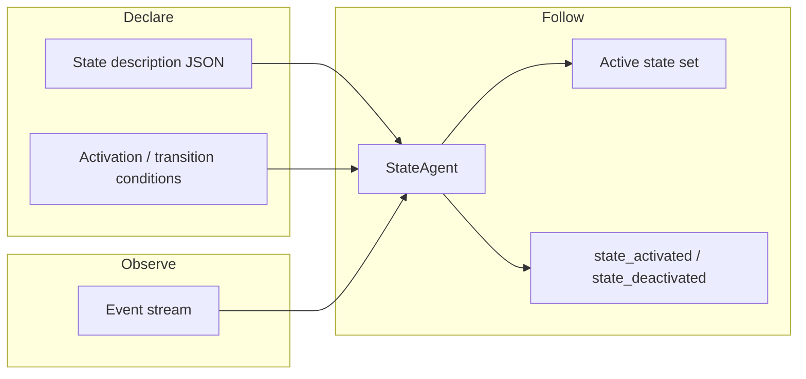
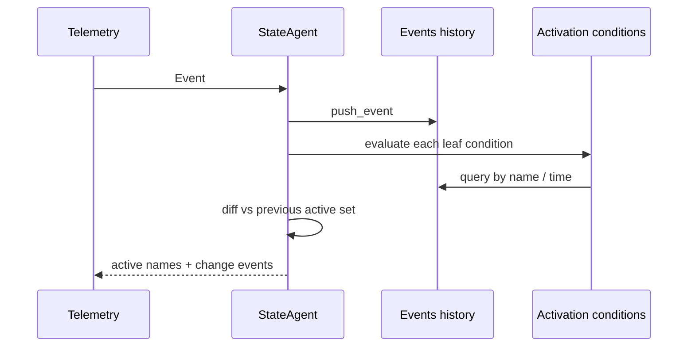

# Tutorial: using `event_statemachine_follow`

This tutorial walks through the crate end-to-end: concepts from the fleetee state-machine specifications, then concrete Rust usage—from a single expression to a live follow agent.

Companion references:

- [parsing.md](parsing.md) — grammar and parse APIs  
- [library.md](library.md) — module / type catalogue  
- [service.md](service.md) — agent contract  
- Spec sample: [`doc/language_evaluation/use_case_device_state_machine.md`](../../doc/language_evaluation/use_case_device_state_machine.md)  
- Expression notes: [`use_cases_event_state_machine_grammars/event_transition_expression_language.json`](../../use_cases_event_state_machine_grammars/event_transition_expression_language.json)

---

## 1. What problem this crate solves

Fleetee supervises IoT devices by **following** their status from a stream of observations (events). Status is not a single enum hard-coded in Rust: it is declared as a **hierarchical state machine** whose leaves become active when **conditions over event history** hold.

From the product design intent:

- Devices are digital twins whose health, connectivity, and business purpose are monitored.
- Declarative descriptions (DDL / state JSON) define *what* to watch; the runtime *follows* live events against those rules.
- The state machine can be adjusted (policy / description) to reveal the wished operational view without rewriting application code.

`event_statemachine_follow` is the **autonomous** library that implements that follow loop. It does **not** own fleetee’s fact ontology; conditions are timed event expressions evaluated against a stored event history.



---

## 2. Mental model: managing vs following

### Managing (description time)

You **manage** the machine by writing JSON:

| Concept | Meaning in this crate |
|---------|------------------------|
| **State group** | Nested container (`not_operational`, `operational`) — may have child `states` and `transitions` |
| **Leaf / aspect** | State with an activation rule (`facts.condition` in JSON → `activation` in Rust) |
| **Activation condition** | Timed event expression: “this aspect is *currently true*” given history |
| **Transition** | Named edge `from` → `to` with its own condition + optional `action` metadata |
| **Full name** | Dotted path: `not_operational.unconnected` |

Several aspects can be **active at once** (orthogonal / overlapping views). Parent groups are naming scopes; activation is evaluated per leaf that has a condition.

### Following (runtime)

You **follow** by feeding `Event`s into `StateAgent`:

1. Append the event to per-device history (`Events`).
2. Recompile / evaluate every leaf activation condition against that history.
3. Diff previous vs new active names.
4. Emit synthetic change events for the host.

Transitions are part of the **managed** graph (parsed, queryable, usable by hosts/LSP). The default agent hot path **follows activations**, not automatic transition firing or command execution—see §10.

---

## 3. Add the dependency

Workspace member:

```toml
# Cargo.toml
[dependencies]
event_statemachine_follow = { path = "../event_statemachine_follow" }
```

Or via fleetee re-exports:

```rust
use fleetee::{event, event_parser, follow};
use fleetee::ddl::state_description::StateDescription;
```

This tutorial uses the crate name directly.

```rust
use event_statemachine_follow::{
    follow::StateAgent,
    state_description::StateDescription,
    state_machine::StateMachine,
    event::{Event, EventValue},
    event_filter_executor::Events,
    event_parser::{
        evaluate_filter_expression, parse_expression, FilterContext, FilterEvaluator,
    },
};
use std::cell::RefCell;
use std::collections::HashMap;
use std::rc::Rc;
```

---

## 4. Events: the unit of observation

Every observation is an `Event`:

```rust
let mut attrs = HashMap::new();
attrs.insert("wifi".into(), EventValue::String("factory_display_001".into()));
attrs.insert("status".into(), EventValue::Boolean(true));
attrs.insert("value".into(), EventValue::Float(42.5));

let event = Event::new(
    "ConnectionTraceFromDevice".into(), // name
    false,                               // is_state
    attrs,
    1_700_000_000_000,                   // timestamp (u64, your clock unit)
);
```

| Field | Role |
|-------|------|
| `name` | Matched by expressions (`ConnectionTraceFromDevice`, `temperature`, …) |
| `is_state` | Marker for state-like events (available to hosts; filters match primarily on `name`) |
| `attributes` | Compared in `#[attr op value]` filters |
| `timestamp` | Ordering, ranges, and `since … from now` anchors |

`EventValue` variants: `String`, `Integer`, `Boolean`, `Float`, `Null`.

---

## 5. Step 1 — parse and evaluate a single expression

Before wiring a full machine, practice the expression language.

### 5.1 Parse only

```rust
let tree = parse_expression("temperature#[value > 20]")?;
// tree: Rc<ExprContextAll<'_>> — borrows the input string lifetime
```

### 5.2 Evaluate against a small history

```rust
let mut store = Events::new();
store.push_event(Event::new(
    "temperature".into(),
    false,
    HashMap::from([("value".into(), EventValue::Float(25.0))]),
    1000,
));

let events = Rc::new(RefCell::new(store));
let ctx = FilterContext::new(Rc::clone(&events));

let current = Event::new("tick".into(), false, HashMap::new(), 1000);

let ok = evaluate_filter_expression(
    "temperature#[value > 20]",
    ctx,
    &current,
)?;
assert!(ok);
```

### 5.3 Expression cookbook (from specs / grammar)

Full writing guide: [expressions.md](expressions.md).

| Goal | Example |
|------|---------|
| Event seen | `enrollment` |
| Attribute filter | `temperature#[value > 30]` |
| Combine filters | `DataCollectionSuccess#[wifi == "factory_display_001" AND status == true]` |
| Boolean | `A AND B`, `A OR B`, `(NOT A) AND B` |
| Any stored event | `*` |
| Time window | `connection_to_cloud since 72 hours from now` |
| Negated freshness | `NOT (enrollment since 72 hours from now OR connection_to_cloud since 72 hours from now)` |
| Name with `@` | `connected@` (matches an event named `connected`) |
| Combined (spec style) | `ConnectionTraceFromDevice#[wifi == "factory_display_001" AND status == true] AND DataCollectionSuccess#[…] since 72 hours from now` |

Time units: `second(s)`, `minute(s)`, `hour(s)`, written in lowercase. Time anchors: `now`, `last event of [e1, e2]`. `since` applies to the single event term on its left. `NOT` applies to the rest of the sentence unless you parenthesize it.

### 5.4 History semantics (critical)

Conditions match against **stored history**, not only the latest event.

```text
t=1000  temperature value=40   →  "temperature#[value > 20]"  true
t=1001  temperature value=10   →  same expression still true
                                  (the t=1000 event remains in Events)
```

Design activation rules with that in mind (time windows, `NOT`, or host-side history policies) if you need “latest reading only” behavior.

---

## 6. Step 2 — declare a state machine (JSON)

Aligned with [`use_case_device_state_machine.md`](../../doc/language_evaluation/use_case_device_state_machine.md) and `tests/state_description.json`.

### 6.1 Minimal machine

```json
{
  "states": {
    "hot": {
      "description": "Temperature above threshold",
      "facts": {
        "condition": "temperature#[value > 30]"
      }
    },
    "cold": {
      "facts": {
        "condition": "temperature#[value < 10]"
      }
    }
  }
}
```

JSON key `"facts"` is historical wire format. In Rust:

```rust
state.activation  // Option<ActivationRule> { condition: String }
```

### 6.2 Hierarchical groups + transitions (spec sample)

```json
{
  "states": {
    "not_operational": {
      "states": {
        "unconnected": {
          "description": "The device is not connected to the network",
          "facts": {
            "condition": "NOT (enrollment since 72 hours from now OR connection_to_cloud since 72 hours from now)"
          }
        },
        "un_enrolled": {
          "description": "The device is not enrolled in the system",
          "facts": {
            "condition": "NOT enrollment_id_created"
          }
        }
      },
      "transitions": [
        {
          "name": "enroll_device_transition",
          "from": "not_operational.unconnected",
          "to": "not_operational.un_enrolled",
          "condition": "user_validation_on_this_device_status",
          "action": {
            "name": "enroll_device",
            "description": "Enroll the device in the system"
          }
        }
      ]
    },
    "operational": {
      "states": {
        "operating": {
          "description": "Device is operating normally",
          "facts": {
            "condition": "ConnectionTraceFromDevice#[wifi == \"factory_display_001\" AND status == true]"
          }
        }
      },
      "transitions": [
        {
          "name": "resume_operation_transition",
          "from": "operational.operating",
          "to": "operational.operating",
          "condition": "ConnectionTraceFromDevice#[wifi == \"factory_display_001\" AND status == true]",
          "action": {
            "name": "resume_operation",
            "description": "Resume normal operation"
          }
        }
      ]
    }
  }
}
```

**Spec checklist when managing descriptions:**

- Event names used in conditions should exist in your telemetry vocabulary.
- Prefer adjusting the **description/policy** to reveal the wished state rather than hard-coding branches in the host.
- Nested states get dotted ids (`not_operational.unconnected`); transition `from` / `to` must use those full paths.

### 6.3 Load and inspect in Rust

```rust
let description = StateDescription::from_json(include_str!(
    "../../tests/state_description.json"
))?;

println!("leaf states: {:?}", description.get_all_state_names());
println!(
    "unconnected if: {:?}",
    description.get_state_condition("not_operational.unconnected")
);

let (event_names, has_wildcard) = description.collect_all_event_names_and_wildcards();
println!("referenced events: {:?}, wildcard={}", event_names, has_wildcard);

let machine: StateMachine = description.to_state_machine()?;
let aspect = machine.get_state_by_name("operational.operating").unwrap();
assert!(!aspect.borrow().activation_conditions().is_empty());
```

---

## 7. Step 3 — follow with `StateAgent`

This is the main library service for **state following**.

### 7.1 Create the agent

```rust
let description = StateDescription::from_json(r#"{
  "states": {
    "hot":  { "facts": { "condition": "temperature#[value > 30]" } },
    "cold": { "facts": { "condition": "temperature#[value < 10]" } }
  }
}"#)?;

let mut agent = StateAgent::new("factory_display_001".into(), description)?;
```

`new` builds the `StateMachine` and an empty `Events` store for that device.

### 7.2 Feed events and read follow results

```rust
fn temp(value: f64, ts: u64) -> Event {
    Event::new(
        "temperature".into(),
        false,
        HashMap::from([("value".into(), EventValue::Float(value))]),
        ts,
    )
}

let (active, changes) = agent.event_arrived_so_evaluate_states(&temp(40.0, 1000))?;
// active typically includes "hot"
// changes contains Event { name: "state_activated", attributes.state = "hot", ... }

assert!(agent.get_current_states().contains("hot"));

for e in &changes {
    println!("{} → {:?}", e.name, e.attributes.get("state"));
}
```

### 7.3 What the agent returns

| Return | Meaning |
|--------|---------|
| `Vec<String>` | **Full** set of currently active state names after this event |
| `Vec<Event>` | Only **diffs**: `state_activated` / `state_deactivated` with attr `state` |

Host pattern:

```rust
let (active, changes) = agent.event_arrived_so_evaluate_states(&event)?;
update_dashboard(&agent.id, &active);
for change in changes {
    forward_to_bus(change); // or inventory / MQTT / actors
}
```

### 7.4 Follow loop (one device)



Use **one agent per device id**. Do not share one agent across devices unless you intentionally share history.

---

## 8. End-to-end scenario: enrollment / connectivity follow

Story from the specs: reveal whether a device is unconnected, un-enrolled, or operating—by following enrollment and connection events.

```rust
let json = r#"{
  "states": {
    "not_operational": {
      "states": {
        "unconnected": {
          "facts": {
            "condition": "NOT (enrollment since 72 hours from now OR connection_to_cloud since 72 hours from now)"
          }
        },
        "un_enrolled": {
          "facts": { "condition": "NOT enrollment_id_created" }
        }
      }
    },
    "operational": {
      "states": {
        "operating": {
          "facts": {
            "condition": "ConnectionTraceFromDevice#[status == true]"
          }
        }
      }
    }
  }
}"#;

let mut agent = StateAgent::new(
    "dev-42".into(),
    StateDescription::from_json(json)?,
)?;

// Fresh device, no history → NOT enrollment_id_created holds → un_enrolled active
// (and unconnected may also hold depending on empty-history interpretation of "since")

let e1 = Event::new("enrollment_id_created".into(), false, HashMap::new(), 10_000);
let (active, changes) = agent.event_arrived_so_evaluate_states(&e1)?;
println!("after enrollment_id_created: {:?}", active);

let mut attrs = HashMap::new();
attrs.insert("status".into(), EventValue::Boolean(true));
let e2 = Event::new("ConnectionTraceFromDevice".into(), false, attrs, 10_100);
let (active, changes) = agent.event_arrived_so_evaluate_states(&e2)?;
println!("after connection trace: {:?}", active);
for c in changes {
    println!("change: {} {:?}", c.name, c.attributes);
}
```

Interpret results as **overlapping aspect truths**, not a single exclusive FSM state—unless you write mutually exclusive conditions.

---

## 9. Working with the event store directly

When you need custom evaluation outside the agent:

```rust
let mut events = Events::new();
events.push_event(/* … */);

// Fast lookups
let latest = events.get_latest_event_by_name("temperature");
let named = events.get_events_by_name("temperature");
let window = events.get_events_by_name_in_range("temperature", 900, 1100);

let rc = Rc::new(RefCell::new(events));
let evaluator = FilterEvaluator::new(FilterContext::new(Rc::clone(&rc)));
let expr = parse_expression("temperature#[value > 20]")?;
let current = Event::new("probe".into(), false, HashMap::new(), 1100);
let matched = evaluator.evaluate_events(&expr, &current)?;
```

`EventFilterExecutor` wraps a filter + store; prefer `Events` + `FilterEvaluator` for most library use today.

---

## 10. Transitions and actions (managing vs executing)

### What is stored

On `to_state_machine()`:

- Each transition’s `condition` is parsed into `Transition.condition`.
- `action` becomes `Command { name, description }` — **metadata only**.

### What the agent does *not* do (yet)

- Automatically take transitions when their condition becomes true  
- Run enroll / connect / resume commands  

### How a host can use transitions

```rust
let description = StateDescription::from_json(json)?;
let machine = description.to_state_machine()?;

let rc_events = Rc::new(RefCell::new(Events::new()));
// … push events …
let ctx = FilterContext::new(Rc::clone(&rc_events));
let current = /* last event */;

let fired = machine.evaluate_transitions(ctx, &current);
for t in fired {
    println!(
        "transition {} → {} action={:?}",
        t.from.borrow().state_name(),
        t.to.borrow().state_name(),
        t.action
    );
    // Host decides: send MQTT command, update plan, etc.
}
```

Spec guidance: transitions express *intended* management moves (enroll, connect, resume); the follow library exposes when their event conditions hold so upper layers can act.

---

## 11. Tooling: source locations and LSP

For editors / diagnostics, use `StateParser` instead of bare `from_json`:

```rust
use event_statemachine_follow::state_description::StateParser;

let mut parser = StateParser::new(source_text.to_string());
let decorated = parser.parse_with_locations()?;
if let Some(loc) = parser.get_location("not_operational.unconnected.facts") {
    println!("activation rule at line {}, col {}", loc.line, loc.column);
}
```

Location keys keep the JSON path segment `.facts` even though the Rust field is `activation`.

Validate that referenced events exist in your catalogue (spec requirement)—`collect_all_event_names_and_wildcards` helps automate that check.

---

## 12. Recommended workflow checklist

1. **Define event vocabulary** — names + attributes your devices emit.  
2. **Write activation conditions** — boolean truths you want to *follow*.  
3. **Nest into groups** — `not_operational` / `operational` style.  
4. **Add transitions + actions** — declarative management edges for the host.  
5. **`from_json` → validate** event names / parse errors.  
6. **`StateAgent::new`** per device.  
7. **Stream events** — apply `event_arrived_so_evaluate_states`.  
8. **Consume** active set + `state_activated` / `state_deactivated`.  
9. **Optionally** call `evaluate_transitions` to drive commands.  
10. **Tune the description** when the wished view changes—prefer policy over code.

---

## 13. Common pitfalls

| Pitfall | What happens | Mitigation |
|---------|--------------|------------|
| Expecting exclusive states | Several leaves stay active together | Write mutually exclusive conditions or interpret as aspects |
| “Latest value only” | Old matching events keep a condition true | Use `since …`, redesign condition, or prune history in the host |
| Wrong transition paths | `to_state_machine` errors | Use full dotted names in `from` / `to` |
| Lifetime of parse trees | `ExprContextAll` borrows the string | Prefer `StateDescription` / agent APIs that own compilation |
| JSON field `facts` vs Rust `activation` | Confusion when reading structs | Same wire key; Rust name is `activation` |
| Sharing one agent for many subjects | Mixed histories | One agent per `id`. In the fleet, that id is the device id |

---

## 14. Where to go next

- Full fixture: `tests/state_description.json`  
- Grammar: `TimeExprGrammar.g4`  
- Agent tests: `src/follow/test.rs`  
- Deeper API tables: [library.md](library.md), [service.md](service.md)
- Runnable walk-through: `cargo run -p event_statemachine_follow --example factory_display` (`examples/factory_display.rs`)
